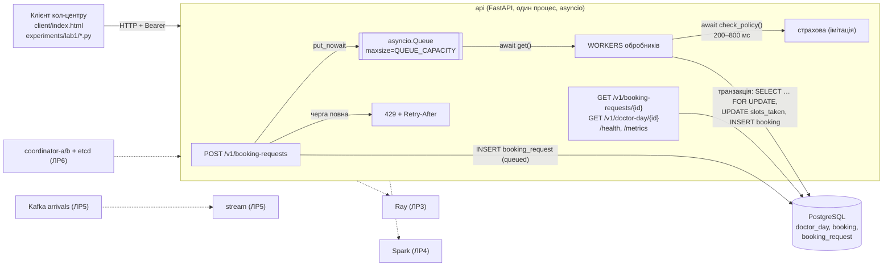

# Запис до клініки – проєкт курсу «Розподілені та паралельні обчислення»

> Опис реалізованого проєкту та його результатів за шаблоном [README-template.md](README-template.md).
> Опис наданого каркаса – [README-kit.md](README-kit.md). Поточний стан: **виконано ЛР1**, ЛР2–ЛР6 – у роботі.

## 1. Курс і тема

| | |
|---|---|
| Курс | Розподілені та паралельні обчислення (DPC) |
| Тема | C02. Запис до клініки |
| Команда | Шабалов |

## 2. Проєкт

Платформа запису мережі клінік. Кол-центр (і сайт) надсилає запити на запис, сервіс займає слоти дня
лікаря, аналітика оцінює черги й неявки.

| Елемент | У цьому проєкті |
|---|---|
| Ресурс | день лікаря `doctor_day` (PostgreSQL): `slots_total`, `slots_taken` |
| Інваріант | `slots_taken` = сума слотів у записах `booking` цього дня **і** `slots_taken <= slots_total` (зайнятих слотів не більше, ніж є). Поле `invariant_ok` у `GET /v1/doctor-day/{id}` |
| Повільний виклик | перевірка поліса в страховій, 200–800 мс (`SLOW_MIN_MS`/`SLOW_MAX_MS`); імітація – `asyncio.sleep`, пацієнти `invalid-*` мають недійсний поліс |
| Предметний ефект | зайняття слотів; ключ – `request_id` (первинний ключ таблиці `booking`) |
| Предметне правило | запит відхиляється (`rejected`), якщо поліс недійсний (`policy-invalid`) або вільних слотів менше, ніж просить запит (`no-free-slots`) |
| Розрахунок ЛР2 | Q(t) = a·t²·(T − t) на [0; T] – кількість людей у черзі реєстратури; інтеграл – сумарне очікування за день у людино-годинах; первісна a·(T·t³/3 − t⁴/4), еталон a·T⁴/12. За формулою Літтла інтеграл / кількість пацієнтів = середній час у черзі _(ЛР2)_ |
| Звіт ЛР4 | частка неявок за лікарями й днями тижня; гарячий ключ – популярний лікар (35 % рядків) _(ЛР4)_ |
| Потік ЛР5 | топік `arrivals` (`event_id, visit_id, doctor_id, late_min, event_time`); фіксоване вікно 30 хв, ключ `doctor_id`, кількість прибуттів із `late_min > 0`; понад 3 – сигнал затримки прийому _(ЛР5)_ |
| Роль ЛР6 | розподільник скасованих слотів; захищений запис – призначення слоту з черги очікування _(ЛР6)_ |

Час подій у контракті – UTC, ISO 8601 з позначкою `Z`, точність до мілісекунд.

## 3. Архітектура



Суцільні лінії – реалізовано (ЛР1), пунктир – наступні роботи.

**Шлях запиту.** `POST /v1/booking-requests` перевіряє, що день лікаря існує, і **синхронно** (`put_nowait`, без
`await` між перевіркою місця та записом) ставить запит у чергу. Якщо місця немає – одразу `429` з `Retry-After`,
у базу нічого не пишеться. Інакше рядок `booking_request` записується зі станом `queued`, і клієнт отримує `202`
з `Location`. Обробник бере запит із черги (`queued → processing`), виконує повільну перевірку поліса **поза**
критичною секцією, потім у транзакції з блокуванням рядка `doctor_day` перевіряє вільні слоти й займає їх
(`done`) або відхиляє (`rejected`). Помилка оброблення – `failed`. Клієнт опитує `GET /v1/booking-requests/{id}`;
перша видача кінцевого стану фіксує позначку `first_read`.

**Навчальні припущення.** Один процес `api`; черга в пам'яті (після аварії процесу запити зі стану `queued`
не відновлюються – О1.1 цього не вимагає). Страхова – імітація затримкою.

### Спільний проєкт

Проєкт виконується лише в курсі DPC. Частину Web (запис через сайт, показ призначень) за потреби
відтворюватимуть генератори запитів; спільні ідентифікатори за карткою – `doctor_day_id`, `patient_id`.

## 4. Структура репозиторію

| Шлях | Призначення |
|---|---|
| `api/app/booking.py` | **ЛР1**: маршрути запиту й ресурсу, обмежена черга, пул обробників, повільний виклик, критична секція (два режими), позначки часу й метрики |
| `api/app/main.py` | запуск черги й обробників у `lifespan`, дренаж черги під час завершення |
| `api/app/config.py` | параметри з середовища (`QUEUE_CAPACITY`, `WORKERS`, `RESOURCE_MODE`, `SLOW_*`, `CS_GAP_MS`, …) |
| `api/app/{auth,db,metrics,middleware,problems,jsonlog,faults}.py` | каркас: токен, пул PostgreSQL, `/metrics`, `X-Request-ID`, Problem Details, журнал JSON, керовані відмови |
| `migrations/001_clinic.sql` | схема: `doctor`, `doctor_day`, `booking`, `booking_request` |
| `migrations/900_clinic_seed.sql` | демодані: `dd-main` (100 000 слотів, для перевірки), `dd-small` (16), тестові `race-locked`, `race-unprotected` (по 20) |
| `openapi.yaml` | контракт API (ролі `x-course`) |
| `checks.yaml` | налаштування засобу перевірки |
| `client/` | вебклієнт: вкладки ЛР1–ЛР6 (`index.html`, `app.js`, `styles.css`, `api.js`); посилання на вкладку – `http://localhost:8083/#lab1` … `#lab6` |
| `experiments/lab1/` | досліди ЛР1: `queue_full.py` (О1.2, О1.5), `race.py` + `reset.sql` (О1.4), `common.py` |
| `results/lab1/` | результати дослідів (CSV, JSON) |
| `compose.yaml`, `configs/`, `coordinator/`, `spark/`, `tools/` | платформа й заготовки наступних робіт із каркаса |

## 5. Збирання й запуск

**Середовище, у якому виконано досліди:** Windows 11, Docker Desktop (Engine 29.9, Compose v5.7), 6 фізичних / 12
логічних ядер, 16 ГБ RAM для Docker; Python 3.14 на хості для клієнтських скриптів (лише стандартна бібліотека).
Для ЛР1 потрібні тільки `postgres`, `migrate`, `api`; для всієї платформи – 10–12 ГБ пам'яті.
Порти: 8000 (api), 5433 (PostgreSQL), 8083 (клієнт), решта – у `.env.example`.

Усі команди – з кореня репозиторію.

```bash
cp .env.example .env                 # PowerShell: Copy-Item .env.example .env
docker compose up -d --build api     # збирання образу, postgres, міграції (сервіс migrate), api
curl -i http://localhost:8000/health
```

Міграції `migrations/NNN_*.sql` застосовує сервіс `migrate` автоматично перед стартом `api`
(перелік: `docker compose run --rm migrate sh /migrate/migrate.sh --list`). Скидання бази до початкового
стану: `docker compose down -v`, потім знову `up`.

Параметри (типові значення – у `compose.yaml` / `.env.example`):

| Змінна | Типово | Зміст |
|---|---|---|
| `API_TOKEN` | `dev-token` | токен `Authorization: Bearer` |
| `QUEUE_CAPACITY` | 50 | місткість черги (без запитів, що вже обробляються) |
| `WORKERS` | 4 | кількість обробників |
| `RESOURCE_MODE` | `locked` | `locked` – критична секція з блокуванням; `unprotected` – без синхронізації (лише тестові дані) |
| `SLOW_MIN_MS` / `SLOW_MAX_MS` | 200 / 800 | тривалість повільного виклику |
| `CS_GAP_MS` | 0 | пауза між перевіркою й зміною ресурсу (розширює вікно гонки для О1.4) |
| `RETRY_AFTER_S` | 1 | значення `Retry-After` у відповіді 429 |

Зміна режиму – змінною середовища під час `up` (перезапускає лише `api`):

```bash
RESOURCE_MODE=unprotected CS_GAP_MS=50 docker compose up -d api
```

PowerShell: `$env:RESOURCE_MODE='unprotected'; $env:CS_GAP_MS='50'; docker compose up -d api`, повернення –
`Remove-Item Env:RESOURCE_MODE, Env:CS_GAP_MS; docker compose up -d api`.

**Клієнт.** `python -m http.server 8083 --bind 127.0.0.1 --directory client`, далі http://localhost:8083.
Приклад запиту з консолі:

```bash
curl -i -X POST http://localhost:8000/v1/booking-requests -H "Authorization: Bearer dev-token" -H "Content-Type: application/json" -d '{"request_id":"req-1","doctor_day_id":"dd-small","patient_id":"p-1","slots":1}'
```

## 6. Лабораторні роботи

### ЛР1. Сервіс із чергою та модель виконання

Модель виконання: один процес, цикл подій `asyncio` (uvicorn). Повільний виклик і доступ до бази – асинхронні
(`asyncio.sleep`, psycopg 3 async), тому очікування не блокує приймання інших запитів і `/health`.

| Пункт | Де реалізовано | Перевірка та свідчення |
|---|---|---|
| О1.1 Ядро. Приймання запитів | `api/app/booking.py`: `create_booking_request` → 202 + `Location`; стани `queued → processing → done \| rejected \| failed` у `booking_request`; `GET /v1/booking-requests/{id}`, `GET /v1/doctor-day/{id}`; міграції `migrations/001_clinic.sql`, `900_clinic_seed.sql` | Дослід «Заповнена черга»: усі 287 прийнятих запитів дійшли до `done`. Недійсний поліс (`patient_id=invalid-7`) → `rejected/policy-invalid`; брак слотів → `rejected/no-free-slots` (дослід О1.4); повторний `request_id` → 409 |
| О1.2 Ядро. Обмежена черга й перевантаження | `asyncio.Queue(maxsize=QUEUE_CAPACITY)`; приймання – `put_nowait`, при `QueueFull` одразу 429 + `Retry-After` до запису в базу | Дослід «Заповнена черга» (розд. 7): довжина черги ≤ 50, 9985 відповідей 429, усі з `Retry-After`; 500 відхилених перевірено – жодного немає в системі (404); p95 `/health` = **3,6 мс** (поріг 100 мс). `results/lab1/queue-full/` |
| О1.3 Ядро. Пул обробників | `booking.start()` створює рівно `WORKERS` задач `_worker`; повільний виклик `check_policy` – `await asyncio.sleep(...)`, цикл подій вільний | `/metrics`: `workers=4`, максимум `processing` під навантаженням = 4 (`queue.csv`); приймання й `/health` відповідали під час повного завантаження обробників |
| О1.4 Ядро. Захист спільного ресурсу | `_book_locked`: транзакція з `SELECT … FOR UPDATE` рядка `doctor_day` – перевірка вільних слотів, `UPDATE slots_taken`, `INSERT booking`, стан запиту. `_book_unprotected` – окреме читання і запис абсолютного значення | Дослід «Гонка за слоти» (розд. 7): 40 одночасних запитів на 20 слотів. Без синхронізації – 26 записів, `slots_taken=20`, `invariant_ok=false`; із блокуванням – 20 `done`, 20 `rejected`, `invariant_ok=true` |
| О1.5 Час виконання й метрики | `Timing` у `booking.py`: `time.monotonic()` у моменти надходження, початку й завершення оброблення та першої видачі кінцевого стану через GET; перевірка порядку позначок (`timing_order_violations`); `/metrics`: `queue_length`, `processing`, `accepted`, `rejected` (429), `outcomes`, `timing_ms` | Дослід «Заповнена черга»: інтервали й вибірки – у розд. 7; `timing_order_violations=0`. `results/lab1/queue-full/timing.csv` |

Додатково перевірено (пункт Д1.4 не заявляється): під час `docker compose stop api` (SIGTERM) `lifespan`
припиняє приймання (у коді – `503`, але uvicorn до цього вже закриває сокет, тож нові клієнти бачать відмову
з'єднання; через це Д1.4 не заявлено) і чекає `queue.join()`: у журналі `booking.draining left=37` → `booking.drained`,
усі 60 поданих запитів мають стан `done`.

**Синхронізація черги (О1.2).** Примітив – `asyncio.Queue` (усередині – `collections.deque` і `asyncio.Future`
очікувачів). Коли черга порожня, обробник у `await queue.get()` реєструє future і призупиняється; цикл подій
його не виконує, доки `put_nowait` не розбудить один future. Активного очікування немає. Перевірка місця й
постановка в чергу – одна синхронна дія `put_nowait`, між ними немає точки перемикання корутин, тож двоє
одночасних клієнтів не займуть останнє місце двічі.

**Критична секція (О1.4).** Охоплює перевірку `slots_taken + slots <= slots_total` і зміну ресурсу; блокування –
рядкове блокування PostgreSQL (`FOR UPDATE`), тож воно діє й між кількома процесами `api`. Повільний виклик
стоїть до критичної секції, тому блокування тримається лише кілька мілісекунд.

### ЛР2. Паралельний чисельний розрахунок

| Пункт | Де реалізовано | Перевірка та свідчення |
|---|---|---|
| _у роботі_ | | |

### ЛР3. Розподілена обробка в Ray і відновлення

| Пункт | Де реалізовано | Перевірка та свідчення |
|---|---|---|
| _заплановано_ | | |

### ЛР4. Пакетний звіт у Spark

| Пункт | Де реалізовано | Перевірка та свідчення |
|---|---|---|
| _заплановано_ | | |

### ЛР5. Потокова обробка, запізнення й відновлення

| Пункт | Де реалізовано | Перевірка та свідчення |
|---|---|---|
| _заплановано_ | | |

### ЛР6. Координація виконавців

| Пункт | Де реалізовано | Перевірка та свідчення |
|---|---|---|
| _заплановано_ | | |

## 7. Досліди

Спільні умови ЛР1: середовище з розд. 5; образ `project-dpc-api:dev`; `QUEUE_CAPACITY=50`, `WORKERS=4`,
повільний виклик 200–800 мс (рівномірно); перед дослідом `api` перезапущено (`docker compose restart api`).

| Дослід | Режим і команда | Що видно / посилання на результат |
|---|---|---|
| Заповнена черга (О1.2, О1.3, О1.5) | `RESOURCE_MODE=locked`; `python experiments/lab1/queue_full.py --clients 16 --seconds 30 --out results/lab1/queue-full` | Черга ≤ 50, 429 з `Retry-After`, p95 `/health` 3,6 мс, усі прийняті – `done`. `results/lab1/queue-full/` |
| Гонка за слоти, із захистом (О1.4) | `RESOURCE_MODE=locked CS_GAP_MS=50`; скидання ресурсу, потім `python experiments/lab1/race.py --doctor-day race-locked` | 20 `done` / 20 `rejected`, `slots_taken=booked=20`, `invariant_ok=true`. `results/lab1/race-locked/` |
| Гонка за слоти, без захисту (О1.4) | `RESOURCE_MODE=unprotected CS_GAP_MS=50`; скидання, `python experiments/lab1/race.py --doctor-day race-unprotected` | 26 `done`, `booked=26 > slots_total=20`, `slots_taken=20` ≠ `booked`, `invariant_ok=false`. `results/lab1/race-unprotected/` |
| Гонка без штучної паузи (О1.4, контроль) | `RESOURCE_MODE=unprotected CS_GAP_MS=0`; те саме | 21 `done`, `booked=21`, `invariant_ok=false` – порушення є й без паузи, пауза лише робить його помітнішим. `results/lab1/race-unprotected-gap0/` |

Скидання тестових ресурсів перед кожним запуском `race.py`:

```bash
docker compose exec -T postgres psql -U app -d app < experiments/lab1/reset.sql
```

PowerShell: `Get-Content experiments/lab1/reset.sql | docker compose exec -T postgres psql -U app -d app`.

#### Заповнена черга (О1.2, О1.3, О1.5)

| Поле | Зміст |
|---|---|
| Пункт і твердження | О1.2: переповнення черги не блокує `/health`, відхилені запити не приймаються. О1.3: працює рівно `WORKERS` обробників. О1.5: інтервали часу кожного запиту |
| Відтворення | 16 потоків-клієнтів 30 с без пауз подають `POST /v1/booking-requests` на `dd-main` (Retry-After навмисно ігнорується, щоб черга лишалась повною). Окремий потік кожні 50 мс вимірює `/health`, ще один кожні 250 мс читає `/metrics`. Потім скрипт чекає спорожнення черги, один раз читає кінцевий стан кожного прийнятого запиту (перша видача) і перевіряє 500 відхилених ідентифікаторів |
| Прогноз | Пропускна здатність ≈ 4 / 0,52 с ≈ 7,7–8 запитів/с; черга постійно повна (50), решта – 429; очікування в черзі ≈ 50 / 7,9 ≈ 6,3 с; p95 `/health` ≪ 100 мс, бо цикл подій не блокується |
| Вимірювання | 10 272 подання: 287 × 202, 9985 × 429 (усі з `Retry-After`), помилок транспорту немає. Максимум `queue_length` = 50, `processing` = 4. Відхилені 500 перевірених запитів – 404 (не потрапили в систему). `/health`: 575 звернень, p50 1,35 мс, **p95 3,61 мс**, p99 7,32 мс, максимум 43 мс. Усі 287 прийнятих – `done`, інваріант `dd-main` виконано |
| Свідчення | `results/lab1/queue-full/summary.json`, `requests.csv`, `health.csv`, `queue.csv`, `timing.csv` |
| Висновок | Черга не перевищує місткості, а перевантаження одразу дає 429, не займаючи пам'яті й обробників. `/health` вклався в поріг із запасом. Це час HTTP-відповіді `/health`, а не час виконання запиту на запис |

Часові інтервали О1.5 (монотонний годинник сервера, мс). Вибірка – **усі 287 прийнятих запитів цього прогону**
(поле `timing` у `GET /v1/booking-requests/{id}`, зведено в `summary.json → timing_this_run_ms`).
`/metrics → timing_ms` показує ті самі інтервали для останніх 2000 завершених запитів процесу.

| Інтервал | Від → до | p50 | p95 | p99 |
|---|---|---|---|---|
| Очікування в черзі | надходження → початок оброблення | 6378 | 6921 | 7099 |
| Оброблення | початок → завершення (поліс + критична секція) | 521 | 759 | 800 |
| Повне виконання | надходження → завершення | 6871 | 7498 | 7687 |
| Очікування видачі | завершення → перша видача через GET | 18 980 | 35 064 | 36 819 |

Очікування видачі велике, бо в цьому досліді клієнти читали результат лише після завершення навантаження;
воно характеризує клієнта, а не сервіс. Для порівняння: `latency_ms` у `/metrics` – час HTTP-відповіді
предметних маршрутів (p95 кілька мілісекунд), і він не дорівнює часу повного виконання запиту (≈ 7 с).
Порядок позначок (надходження ≤ початок ≤ завершення ≤ видача) перевіряється для кожного запиту:
`timing_order_violations = 0`. Позначка видачі з'являється лише під час першого GET кінцевого стану.

#### Гонка за слоти (О1.4)

| Поле | Зміст |
|---|---|
| Пункт і твердження | Без синхронізації інваріант порушується; з критичною секцією – ні |
| Умови | Окремі тестові ресурси: `race-unprotected` і `race-locked`, по 20 слотів. `WORKERS=4`, `CS_GAP_MS=50` в обох режимах (пауза між перевіркою та зміною) |
| Відтворення | Скидання `reset.sql`, перезапуск `api` з потрібним `RESOURCE_MODE`; 40 потоків через бар'єр одночасно подають по запиту на 1 слот; скрипт чекає кінцевих станів і читає ресурс |
| Прогноз | `locked`: рівно 20 `done`, 20 `rejected/no-free-slots`, `slots_taken = booked = 20`. `unprotected`: обробники читають той самий `slots_taken`, обидва бачать вільний слот, а записують `прочитане + 1` – губляться оновлення, `booked > 20` |
| Вимірювання | `locked`: 20 `done` / 20 `rejected`, `slots_taken=20`, `booked=20`, `invariant_ok=true`. `unprotected`: 26 `done` / 14 `rejected`, `slots_taken=20`, `booked=26`, `invariant_ok=false`; без паузи (`CS_GAP_MS=0`) – 21 `done`, `booked=21`, `invariant_ok=false` |
| Висновок | Перевірка «чи є місце» окремо від запису й запис абсолютного значення дають і втрачені оновлення, і перевищення місткості (6 пацієнтів записано понад наявні слоти). Блокування рядка на час «перевірка + зміна» усуває обидва ефекти |

## 8. Межі гарантій і керовані відмови

- Дослід черги – 16 клієнтів, 30 с, один процес `api` на одній машині з Docker Desktop. Результат не поширюється
  автоматично на більше навантаження, кілька екземплярів `api` або інше середовище.
- Черга живе в пам'яті процесу. Під час штатного завершення (SIGTERM) прийняті запити дообробляються (перевірено
  вручну, 60 запитів), але після **аварії** процесу запити в стані `queued`/`processing` залишаються в базі
  незавершеними – збереження черги після аварії О1.1 не вимагає й не перевірялося.
- Позначки монотонного годинника зберігаються в пам'яті процесу; після перезапуску інтервали попередніх запитів
  недоступні (дати в базі – `received_at`, `started_at`, `finished_at`, `first_read_at` – лишаються).
- Режим `unprotected` запускається тільки на `race-unprotected`; після досліду ресурс скидається `reset.sql`.
- Керовані відмови `FAULTS` у ЛР1 не використовуються; `after_effect_before_ack` з'явиться в ЛР3.

## 9. Внесок учасників

| Учасник | Реалізовані пункти й виконані досліди |
|---|---|
| _ПІБ 1_ | _заповнити_ |
| _ПІБ 2_ | _заповнити_ |

### Використані бібліотеки

Точні версії залежностей `api` зафіксовані в `api/uv.lock`.

| Бібліотека | Для чого використана | Місце застосування |
|---|---|---|
| FastAPI, Pydantic | HTTP-маршрути, перевірка тіла запиту | `api/app/booking.py` |
| uvicorn | ASGI-сервер, цикл подій | образ `api` |
| psycopg 3 (async) + psycopg_pool | доступ до PostgreSQL, транзакції, `SELECT … FOR UPDATE` | `api/app/db.py`, `api/app/booking.py` |
| `asyncio` (стандартна бібліотека) | обмежена черга `asyncio.Queue`, обробники-задачі, неблокувальний повільний виклик | `api/app/booking.py` |
| PostgreSQL 17 | ресурс, ефекти, стани запитів | `migrations/` |
| `http.client`, `threading` (стандартна бібліотека) | клієнти дослідів з keep-alive з'єднаннями | `experiments/lab1/` |
| Каркас курсу | `/health`, `/metrics`, токен, Problem Details, журнал, міграції, Compose | `api/app/*`, `configs/`, `compose.yaml` |
