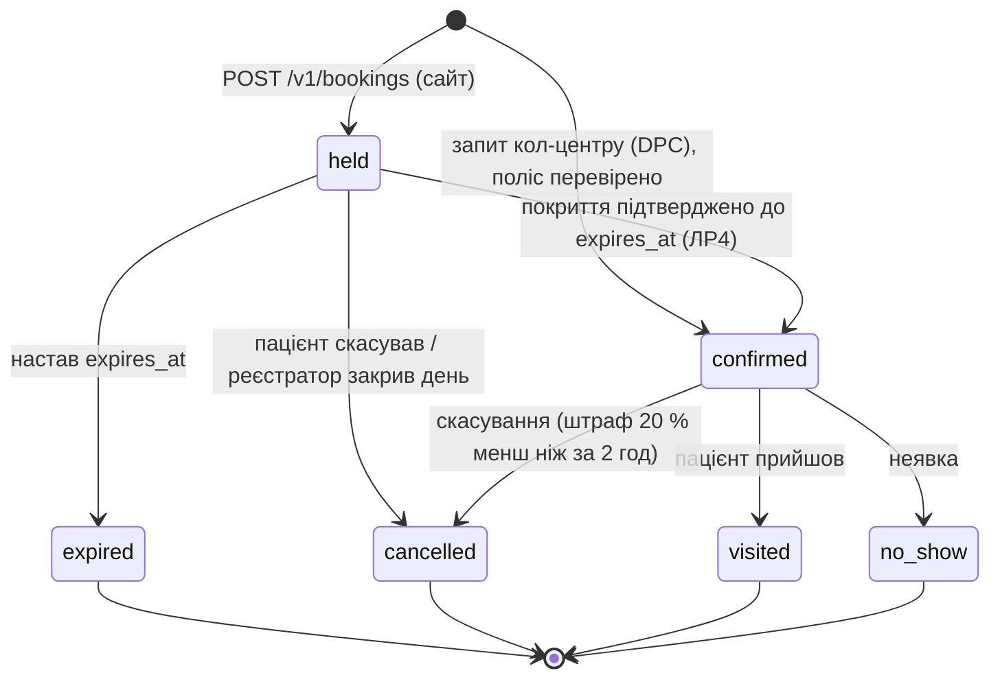
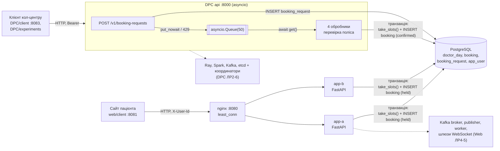
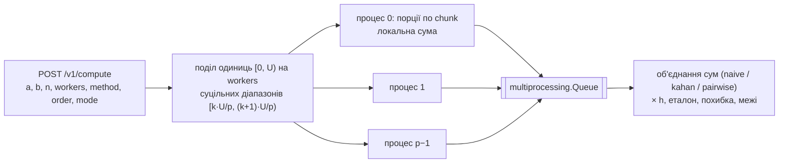

# Запис до клініки - спільний проєкт курсів «Обмін даними у Web-застосунках» і «Розподілені та паралельні обчислення»

> Опис реалізованого проєкту за шаблонами [web/README-template.md](web/README-template.md) і
> [DPC/README-template.md](DPC/README-template.md). Описи наданих каркасів - [web/README-kit.md](web/README-kit.md),
> [DPC/README-kit.md](DPC/README-kit.md). Поточний стан: **виконано ЛР1 і ЛР2 обох курсів**, решта - у роботі.

## 1. Курс і тема


Курси: «Обмін даними у Web-застосунках» (Web) і «Розподілені та паралельні обчислення» (DPC);
Тема: C02. Запис до клініки - спільна тема;
Команда: Шабалов

## 2. Проєкт

Пацієнти записуються до лікарів поліклініки на 15-хвилинні слоти. Сайт (частина Web) дає пацієнту каталог
лікарів, запис і список своїх записів. Кол-центр (частина DPC) приймає записи телефоном через обмежену чергу
з пулом обробників; обробник перевіряє поліс у страховій і займає слоти. Обидва канали ділять той самий ресурс -
слоти дня лікаря. Головна складність - популярний лікар, до якого слоти розходяться за хвилини.

| Елемент | У цьому проєкті |
|---|---|
| Ролі (Web) | пацієнт (`patient`); персонал - реєстратор (`staff`, закриває день лікаря - ЛР3) |
| Головна операція (Web) | `POST /v1/bookings` - утримати 1-2 слоти дня лікаря; запис у стані `held` до `expires_at` (15 хв, `HOLD_MINUTES`) |
| Операція кол-центру (DPC) | `POST /v1/booking-requests` - запит у чергу (202); обробник перевіряє поліс (200-800 мс) і займає слоти; запис одразу `confirmed` |
| Ресурс | день лікаря `doctor_day`: `slots_total`, `slots_taken` (вільно = `slots_total − slots_taken`) |
| Інваріант 1 | зайнятих слотів дня не більше, ніж є: `slots_taken ≤ slots_total` і `slots_taken` = сума слотів активних записів обох каналів (`invariant_ok` у `GET /v1/doctor-day/{id}` DPC) |
| Інваріант 2 | у пацієнта не більше одного активного (`held`/`confirmed`) запису до одного лікаря на день - частковий унікальний індекс, діє для обох каналів |
| Спільне правило | функція бази `take_slots(doctor_day_id, slots)` - блокування рядка дня, перевірка (день є, не закритий, вистачає слотів) і зміна `slots_taken` атомарно в транзакції каналу ([migrations/001_clinic.sql](migrations/001_clinic.sql)) |
| Гроші | ціна слоту - `price_minor` (цілі копійки) + `currency` (`UAH`); вартість запису = ціна × слоти. Штраф 20 % за скасування менш ніж за 2 год - ЛР2/Д1.5 |
| Час | день прийому - `date` у зоні клініки (`clinic_tz`, `Europe/Kyiv`); моменти (`created_at`, `expires_at`) - `timestamptz`, у JSON - RFC 3339 із зоною; клієнт показує їх у зоні клініки |
| Зовнішня система (Web ЛР4) | симулятор «страхова компанія» `POST /coverage`, 1-6 с, 15 % «поліс не покриває» (налаштовано в `web/.env`) |
| Розрахунок (DPC ЛР2) | Q(t) = a·t²·(T − t) на [0; T] - люди в черзі реєстратури; інтеграл - людино-години очікування за день, еталон a·T⁴/12 |
| Звіт (DPC ЛР4), потік (DPC ЛР5) | частка неявок за лікарями й днями тижня; топік `arrivals`, вікно 30 хв, запізнення > 0 за `doctor_id` |
| Роль (DPC ЛР6) | розподільник скасованих слотів; захищений запис - призначення слоту з черги очікування |
| Зміна ЛР6 (Web) | типи прийому: консультація - 1 слот, огляд - 2; запит без типу (клієнт попередньої версії) = консультація |

### Модель області (Web О1.1)

Сутності: `doctor` (лікар), `doctor_day` (день прийому лікаря з місткістю в слотах і ціною слоту), `booking`
(запис пацієнта на 1-2 слоти дня; канал `web` або `call-center`), `app_user` (пацієнт або реєстратор; id пацієнта -
спільний з DPC `patient_id`), `booking_request` (запит кол-центру в черзі DPC).



Слоти займають стани `held`, `confirmed`, `visited`, `no_show`; `expired` і `cancelled` слоти звільняють (ЛР2/ЛР4).
Запит кол-центру: `queued → processing → done | rejected | failed`.

**Навчальні припущення (числові параметри).** Слот - 15 хв; запис - 1 або 2 слоти; утримання `held` - 15 хв;
день лікаря - 16-32 слоти (тестові дні: `dd-main` 100 000 для навантаження, `dd-one` 1 для гонки); ціна слоту
500-900 грн; черга кол-центру - 50 запитів, 4 обробники; перевірка поліса кол-центром - 200-800 мс.

## 3. Архітектура



Суцільні лінії - реалізовано (ЛР1), пунктир - наступні роботи. Технології: Docker Compose, nginx 1.31 (балансувальник
`least_conn`), Python 3.14 + FastAPI + psycopg 3 (async) в обох частинах, PostgreSQL 17 (одна база, версійні SQL-міграції).

**Шлях головної операції (сайт).** Браузер → nginx → `app-a` або `app-b` (стан лише в базі, тож байдуже який) →
одна транзакція: `SELECT take_slots(...)` блокує рядок `doctor_day`, перевіряє правило й збільшує `slots_taken`;
`INSERT booking (held, expires_at)`; `COMMIT` → лише тепер `201 Created` + `Location: /v1/bookings/{id}`. Відмови:
404 (дня немає), 409 (немає слотів, день закрито, уже є активний запис), 422 (неправильні дані), 400 (пошкоджений JSON).

**Шлях запиту кол-центру.** `POST /v1/booking-requests` → `put_nowait` у чергу (повна - одразу 429 + `Retry-After`) →
`202`; обробник: перевірка поліса поза критичною секцією → та сама `take_slots()` + `INSERT booking (confirmed)` +
стан запиту в одній транзакції.

### Спільний проєкт

| Питання | Рішення |
|---|---|
| Хто змінює стан | Записи сайту (`channel = web`) створює лише Web; записи кол-центру (`channel = call-center`) і стани `booking_request` - лише DPC. Ресурс `doctor_day.slots_taken` змінюють обидві частини, але **тільки** через спільну функцію `take_slots()` у своїй транзакції - однакове предметне правило, перевірене атомарно в базі. Довідники (`doctor`, `doctor_day`, `app_user`) задають міграції; закриття дня - дія реєстратора у Web (ЛР3) |
| Як інша частина дізнається | Через спільну базу: DPC бачить записи сайту в тому самому `doctor_day` (`GET /v1/doctor-day/{id}` → `web_bookings`), сайт показує пацієнту записи кол-центру в «Моїх записах» (`channel: call-center`). Події Kafka між частинами - з ЛР4-5 |
| Спільні ідентифікатори й ключі повтору | `doctor_day_id`, `patient_id` (для пацієнтів сайту - id користувача, напр. `p-1001`). Ключ ефекту кол-центру - `request_id` (`booking.request_id UNIQUE`); повторна передача того самого `request_id` → 409 без другого ефекту. Ключ ідемпотентності сайту - `Idempotency-Key` (ЛР2) |
| Контракти | Web: [web/openapi.yaml](web/openapi.yaml) (OpenAPI 3.1, `X-User-Id` до ЛР3). DPC: [DPC/openapi.yaml](DPC/openapi.yaml) (Bearer-токен). Спільна схема: [migrations/](migrations/) |
| Повтори, перестановки, недоступність | Порядок записів не важливий: кожен запис незалежно проходить `take_slots()`; повтор `request_id` відхиляється первинним ключем. Якщо DPC недоступний, сайт працює (і навпаки) - вони не викликають один одного синхронно |
| Наскрізний приклад | Пацієнт `p-1001` записується через сайт на `dd-joint` → `201`, `slots_taken` 0 → 1. Кол-центр подає запит для `p-1001` на той самий день → `202` → обробник: `take_slots()` займає слот, але `INSERT booking` порушує інваріант 2 → транзакцію відкочено → запит `rejected / patient-already-booked`, `slots_taken` лишається 1. На сайті у «Моїх записах» `p-1001` бачить один запис `held`. Сценарій - у [checks.yaml](checks.yaml) (`scenario`) і досліді «Два канали» (розд. 7) |

Результати окремо за пунктами Web і DPC - у розділі 6.

## 4. Структура репозиторію

| Шлях | Призначення |
|---|---|
| `compose.yaml` | спільний запуск: `include` частин Web і DPC, одна база й один `migrate` |
| `migrations/` | **спільна** схема й демодані: `001_clinic.sql` (таблиці, обмеження, `take_slots()`), `002_auth_cancel.sql` (сесії, скасування), `003_idempotency.sql` (ключі ідемпотентності), `900_clinic_seed.sql`, `901_web_lab2_seed.sql` (тестові дні дослідів ЛР2) |
| `checks.yaml` | налаштування засобу перевірки для обох курсів і наскрізний сценарій |
| `experiments/joint/` | дослід «Два канали на один день» (`both_channels.py`, `reset.sql`) і результати |
| `web/server/app/clinic.py` | **Web ЛР1**: каталог, головна операція, список із курсором, поточний користувач `X-User-Id` |
| `web/server/app/idempotency.py`, `ratelimit.py` | **Web ЛР2**: ключі ідемпотентності (займання, збережена відповідь, прибирання порціями); спільний ліміт частоти в Redis |
| `web/server/app/main.py` | підключення маршрутів, CORS, фонове прибирання прострочених ключів |
| `web/server/app/{middleware,jsonlog,problems,service,db,config}.py` | каркас: `X-Request-ID`, журнал JSON, Problem Details, `/health`, пул БД, налаштування |
| `web/openapi.yaml` | контракт Web (перевірено Redocly) |
| `web/client/` | сайт пацієнта: `index.html`, `app.js`, `api.js`, `styles.css` |
| `web/experiments/` | `lab1_check.py` - перевірка ЛР1 Web, `card_routes_check.py`, `reset_web.sql`; `lab2/` - досліди ЛР2 (`race.py`, `idempotency_check.py`, `in_progress.py`, `lost_response.py`, `client_retry.py`, `compare.py`, `explain.py`); результати в `web/results/` |
| `web/compose.yaml`, `web/configs/` | сервіси Web (nginx, app-a/b, postgres, migrate, Kafka, симулятор, шлюзи…) |
| `DPC/api/app/booking.py` | **DPC ЛР1**: черга, пул обробників, повільний виклик, критична секція (два режими), метрики й час |
| `DPC/api/app/compute.py`, `integrate.py` | **DPC ЛР2**: `/v1/compute` (поділ, процеси, об'єднання, еталон, межі похибки, асинхронний режим і скасування), `/v1/histogram`; тіло процесу-частини |
| `DPC/compose.services.yaml`, `DPC/compose.infra.yaml`, `DPC/compose.yaml` | сервіси DPC; інфраструктура для окремого запуску DPC; окремий запуск |
| `DPC/openapi.yaml`, `DPC/checks.yaml` | контракт і перевірка DPC |
| `DPC/client/` | клієнт кол-центру й лабораторних DPC (вкладки ЛР1-ЛР6) |
| `DPC/experiments/lab1/` | досліди DPC ЛР1: `queue_full.py`, `race.py`, `reset.sql`; результати в `DPC/results/lab1/` |
| `DPC/experiments/lab2/` | досліди DPC ЛР2: `correctness.py`, `accuracy.py`, `speedup.py`, `shared_sum.py`, `extras.py`, `profile_summary.py`; результати в `DPC/results/lab2/` |
| `DPC/{spark,coordinator,tools,configs}` | заготовки наступних робіт DPC із каркаса |

## 5. Збирання й запуск

**Середовище, у якому виконано перевірки:** Docker Desktop (Engine 29.9, Compose v5.7); Python 3.14 на хості для клієнтів і дослідів (лише стандартна бібліотека);
Node.js 22 - тільки для лінтера контракту (`npx @redocly/cli`).

**Усі команди - з кореня репозиторію**. Секретів у репозиторії немає; `.env` створюються з прикладів.

```bash
cp web/.env.example web/.env
```

```bash
cp DPC/.env.example DPC/.env
```

```bash
docker compose up -d --build nginx api
```

Ця команда збирає образи, запускає `postgres`, застосовує міграції (`migrate`), `app-a`, `app-b`, `nginx` (а з ним
`broker` і шлюзи, від яких nginx залежить) та `api` DPC. Перевірка: `curl -i http://localhost:8080/health`,
`curl -i http://localhost:8000/health`. Уся платформа обох курсів - `docker compose up -d --build` (≈ 14-16 ГБ).

Міграції - версійні SQL-файли `migrations/NNN_name.sql`, їх застосовує сервіс `migrate` по порядку, кожен один раз
в одній транзакції (`docker compose run --rm migrate sh /migrate/migrate.sh --list`). Скидання бази до демоданих:
`docker compose down -v`, потім знову `up`.

**Клієнти** (кожен в окремому терміналі): сайт пацієнта - http://localhost:8081, кол-центр DPC - http://localhost:8083.

```bash
python -m http.server 8081 --bind 127.0.0.1 --directory web/client
```

```bash
python -m http.server 8083 --bind 127.0.0.1 --directory DPC/client
```

**Облікові записи демоданих.** Пацієнти `p-1001` … `p-1005` (логіни `patient1` … `patient5` / `patient-pass`),
реєстратор `u-registrar` (`registrar` / `registrar-pass`). До ЛР3 сайт передає користувача заголовком `X-User-Id`.
Токен DPC - `dev-token`.

| Що | Адреса |
|---|---|
| API Web через nginx; `app-a`, `app-b` напряму | http://localhost:8080; :8001, :8002 |
| API DPC (кол-центр) | http://localhost:8000 |
| сайт пацієнта; клієнт кол-центру | http://localhost:8081; http://localhost:8083 |
| PostgreSQL (`app`/`app`, база `app`) | localhost:5432 |

Параметри (типові значення - у `web/.env.example`, `DPC/.env.example`): `HOLD_MINUTES=15` (утримання запису сайту);
Web ЛР2 - `INVARIANT_MODE=protected|conditional|unprotected`, `INVARIANT_GAP_MS=0`, `IDEMPOTENCY_TTL_HOURS=24`,
`IDEMPOTENCY_WAIT_MS=200`, `RATE_LIMIT_PER_MIN=120` (Redis запускається разом з app-a/app-b);
DPC - `QUEUE_CAPACITY=50`, `WORKERS=4`, `RESOURCE_MODE=locked|unprotected`, `SLOW_MIN_MS=200`, `SLOW_MAX_MS=800`,
`CS_GAP_MS=0`, `RETRY_AFTER_S=1`. Зміна режиму DPC: `RESOURCE_MODE=unprotected CS_GAP_MS=50 docker compose up -d api`
(PowerShell: `$env:RESOURCE_MODE='unprotected'; $env:CS_GAP_MS='50'; docker compose up -d api`; повернення -
`Remove-Item Env:RESOURCE_MODE, Env:CS_GAP_MS; docker compose up -d api`).

**Окремий запуск частини.** Кожен курс запускається й окремо: `cd web && docker compose up -d --build nginx` або
`cd DPC && docker compose up -d --build api` - обидва беруть ту саму схему з `../migrations`.

## 6. Лабораторні роботи

### Web ЛР1. Контракт, модель і перша операція

| Пункт | Де реалізовано | Перевірка та свідчення |
|---|---|---|
| О1.1 Ядро. Модель області | розд. 2 «Модель області»: сутності, діаграма станів, інваріанти, числові припущення | цей README |
| О1.2 Ядро. Схема БД | [migrations/001_clinic.sql](migrations/001_clinic.sql): PK, FK (`doctor_day → doctor`, `booking → doctor_day`), `NOT NULL`, `CHECK` (слоти 1-2, стани, `price_minor ≥ 0`, валюта `^[A-Z]{3}$`, `held ⇒ expires_at`, інваріант `slots_taken BETWEEN 0 AND slots_total`), `UNIQUE` (`login`, `(doctor_id, day)`, `request_id`, частковий індекс інваріанту 2). Гроші - `bigint` копійок + валюта; дата прийому - `date`, моменти - `timestamptz`, зона - окреме поле `clinic_tz` | міграції застосовує `migrate`; порушення CHECK можливе лише для тестового дня з `unprotected_test` (дослід DPC без захисту) |
| О1.3 Ядро. Контракт API | [web/openapi.yaml](web/openapi.yaml): службові маршрути комплекту, каталог, `bookings` (`x-course: main, list, object`, далі `update, cancel, staff-action, long-operation`), приклади `normal`/`scarce`/`missing`, Problem Details | `npx @redocly/cli@1.34.5 lint web/openapi.yaml` → *valid*, 0 помилок, 7 попереджень (усі є й у прикладі комплекту: навмисно неправильний приклад `forbidden`, `101` для WebSocket тощо) |
| О1.4 Ядро. Головна операція | `create_booking` у [web/server/app/clinic.py](web/server/app/clinic.py): `take_slots()` + `INSERT booking` в одній транзакції, 201 + `Location` після виходу з `conn.transaction()`; 404/409/422/400; id - рядки | `lab1_check.py`: 201 + Location, запис одразу читається власником; missing → 404; `slots=5` і зайве поле `status` → 422; пошкоджений JSON → 400; другий активний запис → 409; останній слот `dd-one`: 1 × 201, 4 × 409 |
| О1.5 Список із курсором | `list_bookings`: лише власні записи, `ORDER BY created_at DESC, id DESC`, `limit` 1-50, непрозорий `next_cursor` (base64url пари «час, id»), keyset-умова `(created_at, id) < (…)`; пошкоджений курсор → 400 | `lab1_check.py`: 6 записів по 2 на сторінку - 3 сторінки, без дублів, від найновіших; чужих записів немає; `limit=0/51` → 422; `cursor=not-a-cursor` → 400 |
| О1.6 Система, `/health`, журнал | одна команда запускає nginx, app-a, app-b, postgres; `/health` без звернення до бази на кожному екземплярі; middleware каркаса: `X-Request-ID`, рядок JSON на кожен запит | `lab1_check.py`: `/health` app-a і app-b; `X-Request-ID` повертається; 20 запитів через nginx розподілено на обидва екземпляри. Рядок журналу: `{"time": "…", "instance": "app-a", "event": "http.request", "request_id": "…", "method": "GET", "route": "/health", "status": 200, "duration_ms": 0.3}` - шаблон маршруту, без тіл, паролів і токенів |
| О1.7 Ядро. Клієнт | [web/client/](web/client/): вибір пацієнта, каталог лікарів і днів, запис (1-2 слоти, причина), показ результату й Problem Details (статус, заголовок, деталі, помилки полів), «Мої записи» - читає **всі** сторінки курсора; читає лише відомі поля, тож нові поля відповіді нічого не ламають; схема «Як це працює» підсвічує екземпляр, що відповів; журнал запитів | перевірено в браузері: запис → «201 · Запис створено», повтор → «409 · Patient already has an active booking…»; `p-1004`: «6 записів, 3 стор.» |

Перевірка одним запуском (із кореня, стек запущено): `python web/experiments/lab1_check.py` - 23/23 OK,
свідчення - [web/results/lab1/summary.json](web/results/lab1/summary.json). Повторний запуск - після
`docker compose exec -T postgres psql -U app -d app < web/experiments/reset_web.sql`.

### Web ЛР2. Конкуренція та повторення запитів

| Пункт | Де реалізовано | Перевірка та свідчення |
|---|---|---|
| О2.1 Ядро. Інваріант за одночасних запитів | `_take_slots()` у [web/server/app/clinic.py](web/server/app/clinic.py), робочий режим `INVARIANT_MODE=protected`: функція бази `take_slots()` блокує рядок `doctor_day` (`SELECT … FOR UPDATE`) і в тій самій транзакції перевіряє правило та змінює `slots_taken`. Альтернатива для порівняння — `conditional` (атомарний умовний `UPDATE … WHERE slots_taken + n <= slots_total`) | Дослід «20 пацієнтів на останній слот» через **обидва екземпляри** (по 10 напряму на app-a і app-b): `protected` — 1 × 201, 19 × 409, `slots_taken = booked = 1`, `invariant_ok=true`; `conditional` — так само. На окремому тестовому дні в режимі `unprotected` (читання → пауза 50 мс → запис) — 20 × 201 на 1 слот, `invariant_ok=false` |
| О2.2 Ядро. Механізм ідемпотентності | [web/server/app/idempotency.py](web/server/app/idempotency.py), таблиця `idempotency_key` ([migrations/003_idempotency.sql](migrations/003_idempotency.sql)): користувач, операція, ключ, відбиток тіла (SHA-256 канонічного JSON), стан, статус, тіло й заголовки відповіді, строк 24 год. Ключ займається `INSERT … ON CONFLICT` у **тій самій транзакції**, що й запис пацієнта, і там же отримує збережену відповідь — фіксуються разом. Дублікат під час обробки чекає на унікальному індексі не довше `IDEMPOTENCY_WAIT_MS` (200 мс), інакше 409 з `Retry-After`. Прострочені ключі прибирає фонова задача кожного екземпляра порціями по 500 (`FOR UPDATE SKIP LOCKED`) | `idempotency_check.py` **10/10 OK**: без ключа — 400; повтор через інший екземпляр (поля в іншому порядку) — той самий 201, той самий `id`, `Idempotent-Replayed: true`; інше тіло — 422; той самий ключ іншого користувача — окрема операція; збережена відмова 409 повторюється; 12 одночасних дублікатів через обидва екземпляри — 1 запис, усі 12 відповідей з тим самим `id`; 1 200 прострочених ключів прибрано порціями. `in_progress.py`: дублікат під час довгої транзакції — 409 `idempotency-key-in-progress` з `Retry-After: 1`, після фіксації — збережений 201 |
| О2.3 Повтор після втраченої відповіді | `fault("after_commit_before_response")` у `create_booking` — одразу після COMMIT, до відповіді | `lost_response.py`: запит на app-a — транзакцію зафіксовано, процес упав (у журналі `fault.hit`), клієнт без відповіді; той самий ключ через app-b — 201 зі збереженим `id`; після перезапуску app-a — те саме; запис пацієнта один, `slots_taken` зріс на 2 рівно один раз |
| О2.4 Повторні спроби в клієнті | `callWithRetry()` у [web/client/api.js](web/client/api.js), `book()` у [web/client/app.js](web/client/app.js): один ключ на дію користувача, той самий у всіх спробах; повтор при обриві, 429, 502–504 і 409 «ключ обробляється»; пауза `random(0, min(4 с, 0,3 с·2^(n−1)))`, не менша за `Retry-After`; ≤ 5 спроб і ≤ 15 с; інакше «Результат невідомий» із кнопкою перевірки тим самим ключем | `client_retry.py` у реальному браузері (Edge): втрачена відповідь → «Спроба 2; сервер повернув збережений результат — запис створено один раз», у базі 1 запис; app-a і app-b зупинено → після 5 спроб «Результат невідомий», записів 0; після запуску «Перевірити ще раз (той самий ключ)» → 201, записів 1 |
| Д2.1 Ліміт частоти | [web/server/app/ratelimit.py](web/server/app/ratelimit.py): лічильник `rl:<user>:<хвилина>` у Redis, спільний для екземплярів; понад `RATE_LIMIT_PER_MIN=120` змінювальних запитів — 429 з `Retry-After` до кінця хвилини | 130 запитів одного користувача навперемінно на app-a і app-b: 120 пропущено, 10 × 429 (по 5 на кожному екземплярі), `Retry-After` присутній |
| Д2.2 Порівняння двох способів | `INVARIANT_MODE=protected` (блокування рядка) і `conditional` (атомарний умовний запис) | `compare.py`: 100 пацієнтів на 50 слотів через nginx, 5 раундів на режим — обидва: 50 × 201, 50 × 409, інваріант виконано. Медіани: тривалість раунду 312 мс проти 308 мс, p95 відповіді 292 мс проти 293 мс — різниця в межах шуму |
| Д2.3 Другий інваріант | частковий унікальний індекс `booking_one_active_per_patient_day` (з ЛР1) | другий активний запис до лікаря на день — 409 `already-booked` |
| Д2.4 Умовна зміна | `PATCH /v1/bookings/{id}`: `If-Match` = ETag, перевірка версії й запис — один `UPDATE … WHERE version = %s` | `card_routes_check.py`: без заголовка — 428, застаріла версія — 412, поточна — 200 і нова версія |
| Д2.5 Повторне скасування | `POST /v1/bookings/{id}/cancel`: рядок блокується, `release_slots()` лише при переході `held/confirmed → cancelled` | повторне скасування — той самий стан, вільних слотів не додається |
| Д2.7 План запиту | `explain.py`: 100 000 записів, `EXPLAIN (ANALYZE, BUFFERS)` запиту списку до й після індексу `booking_patient_newest (patient_id, created_at DESC, id DESC)` | без індексу — `Seq Scan` 100 450 рядків + `top-N heapsort`, 1 560 буферів, **8,0 мс**; з індексом — `Index Scan` у потрібному порядку, зупиняється на 21-му рядку, без сортування, 28 буферів, **0,19 мс**. Послідовне сканування не вимикалось. Плани — `web/results/lab2/explain/` |

**Чому блокування рядка (О2.1).** Перевірка й зміна спільного ресурсу виконуються в базі, тож захист діє між
`app-a` і `app-b` та між сайтом і кол-центром DPC (локальний м'ютекс одного екземпляра цього не дав би).
Блокування рядка обрано як робочий режим, бо в одній функції бази `take_slots()` воно поєднує всі перевірки
правила (день існує, не закритий, вистачає слотів) і однаково викликається обома частинами проєкту. Атомарний
умовний `UPDATE` (`conditional`) захищає так само (дослід Д2.2), але причину відмови доводиться з'ясовувати
окремим читанням. Серіалізовна транзакція потребувала б повторів у разі конфлікту — без потреби, бо конфлікт
стосується одного рядка.

Повний набір перевірок ЛР2 (із кореня, стек запущено; скрипти самі перезапускають app-a/app-b з потрібним режимом):

```bash
python web/experiments/lab2/race.py --mode protected
```

```bash
python web/experiments/lab2/idempotency_check.py
```

```bash
python web/experiments/lab2/lost_response.py
```

`race.py --mode conditional|unprotected --gap-ms 50`, `in_progress.py`, `compare.py --rounds 5`, `explain.py`,
`client_retry.py` (потрібні `pip install playwright` і клієнт на :8081) — решта дослідів. Результати — `web/results/lab2/`.

### DPC ЛР1. Сервіс із чергою та модель виконання

Модель виконання: один процес, цикл подій `asyncio` (uvicorn). Повільний виклик і доступ до бази - асинхронні
(`asyncio.sleep`, psycopg 3 async), тому очікування не блокує приймання інших запитів і `/health`.

| Пункт | Де реалізовано | Перевірка та свідчення |
|---|---|---|
| О1.1 Ядро. Приймання запитів | [DPC/api/app/booking.py](DPC/api/app/booking.py): `create_booking_request` → 202 + `Location`; стани `queued → processing → done \| rejected \| failed` у `booking_request`; `GET /v1/booking-requests/{id}`, `GET /v1/doctor-day/{id}` | «Заповнена черга»: усі 288 прийнятих - `done`. Недійсний поліс (`invalid-*`) → `rejected/policy-invalid`; брак слотів → `rejected/no-free-slots`; пацієнт уже записаний через сайт → `rejected/patient-already-booked`; повторний `request_id` → 409 |
| О1.2 Ядро. Обмежена черга й перевантаження | `asyncio.Queue(maxsize=QUEUE_CAPACITY)`; приймання - `put_nowait`, при `QueueFull` одразу 429 + `Retry-After` до запису в базу | «Заповнена черга»: черга ≤ 50, 9977 × 429 - усі з `Retry-After`; 500 відхилених перевірено - жодного в системі; p95 `/health` = **3,8 мс** (поріг 100 мс) |
| О1.3 Ядро. Пул обробників | `booking.start()` створює рівно `WORKERS` задач; `check_policy` - `await asyncio.sleep(...)` | `/metrics`: `workers=4`, максимум `processing` = 4; приймання й `/health` відповідали під час повного завантаження |
| О1.4 Ядро. Захист спільного ресурсу | `_book_locked`: транзакція - блокування рядка `doctor_day`, спільна `take_slots()`, `INSERT booking`, стан запиту. `_book_unprotected` - окреме читання і запис абсолютного значення (тільки `race-unprotected`) | «Гонка за слоти»: 40 запитів на 20 слотів. Без синхронізації - 32 записи, `invariant_ok=false`; із блокуванням - 20 `done` / 20 `rejected`, `invariant_ok=true` |
| О1.5 Час виконання й метрики | `Timing`: `time.monotonic()` у моменти надходження, початку й завершення оброблення та першої видачі кінцевого стану через GET; перевірка порядку (`timing_order_violations`); `/metrics`: `queue_length`, `processing`, `accepted`, `rejected`, `outcomes`, `timing_ms` | «Заповнена черга»: інтервали - у розд. 7; `timing_order_violations=0`; `DPC/results/lab1/queue-full/timing.csv` |

**Синхронізація черги (О1.2).** Примітив - `asyncio.Queue` (усередині - `deque` і `asyncio.Future` очікувачів).
Порожня черга: обробник у `await queue.get()` реєструє future і призупиняється, цикл подій його не виконує, доки
`put_nowait` не розбудить future - активного очікування немає. Перевірка місця й постановка в чергу - одна синхронна
дія `put_nowait` без точки перемикання корутин, тож двоє клієнтів не займуть останнє місце двічі.

**Критична секція (О1.4).** Охоплює перевірку `slots_taken + slots ≤ slots_total` і зміну ресурсу; блокування -
рядкове блокування PostgreSQL (`FOR UPDATE` у `take_slots()`), тож воно діє між обробниками DPC, екземплярами
`app-a`/`app-b` і між каналами. Повільний виклик стоїть до критичної секції.

Додатково перевірено (Д1.4 не заявляється): під час SIGTERM `lifespan` припиняє приймання й чекає `queue.join()` -
усі прийняті запити дообробляються (60 із 60 `done`); нові клієнти бачать відмову з'єднання, а не 503, бо uvicorn
закриває сокет раніше.

### DPC ЛР2. Паралельний чисельний розрахунок

Функція картки Q(t) = amp·t²·(T − t) — кількість людей у черзі реєстратури (amp = 0,1 особи/год³, T = 12 год,
пік ≈ 25,6 особи о 8-й годині). Інтеграл на [0; 12] — сумарне очікування за день: еталон через первісну
amp·(T·t³/3 − t⁴/4) дорівнює **172,8 людино-години**; за формулою Літтла для 400 пацієнтів середній час у черзі
172,8 / 400 год ≈ **25,9 хв** (поле `avg_wait_min`).

**Схема розрахунку (О2.1).**



Одиниця сітки: для середніх прямокутників і трапецій — відрізок (U = n), для Сімпсона — пара відрізків (U = n/2),
тож діапазони не мають пропусків і перекриття, а кінці пар Сімпсона рахуються в кожній парі окремо.
**Послідовна частина:** перевірка параметрів, створення процесів (`Process.start`), збирання результатів із черги,
`join`, об'єднання сум, еталон і межі похибки. Вона триває ≈ 0,02 с проти ≈ 2,2 с обчислення одним процесом (≈ 1 %).

| Пункт | Де реалізовано | Перевірка та свідчення |
|---|---|---|
| О2.1 Ядро. Паралельне інтегрування | [DPC/api/app/compute.py](DPC/api/app/compute.py) (маршрут, поділ, об'єднання, еталон), [DPC/api/app/integrate.py](DPC/api/app/integrate.py) (тіло процесу; легкий модуль без FastAPI) — `POST /v1/compute` з `a, b, n, workers, method, order` | `correctness.py`, n = 10⁶: для 1, 2 і 4 процесів і трьох методів відносна похибка ≤ 10⁻¹² (допуск 10⁻⁶), розкид між p — 3·10⁻¹⁶ |
| О2.2 Дослідження точності | межа методу (`method_error_bound`): середні прямокутники (b−a)h²·max\|f''\|/24, трапеції …/12, Сімпсон (b−a)h⁴·max\|f⁽⁴⁾\|/180; оцінка округлення (`rounding_error_bound`): (кількість доданків)·ε·Σ\|доданків\| | `accuracy.py`: для Q(t) і n = 8…2048 відношення e(n)/e(2n) = **4,000** (середні прямокутники й трапеції), похибка в межах оцінки; Сімпсон на Q(t) — похибка лише округлення (~10⁻¹⁴) за будь-якого n, бо Q кубічна (Q⁽⁴⁾ = 0); на тестовій sin(t) [0; π] відношення → **16,0** |
| О2.3 Ядро. Прискорення | `timing` у відповіді: `spawn_s`, `start_s`, `compute_s`, `collect_merge_s`; параметр `affinity` для перевірки гіпотези | `speedup.py`, n = 2·10⁷, 5 вимірів: Sp₂ = 1,85, Sp₄ = **3,04** (Ep₄ = 0,76); профіль py-spy, гіпотеза й повторний вимір — нижче |
| О2.4 Ядро. Спільна сума | `mode`: `none` — `ctx.RawValue`, `+=` без блокування; `lock` — `ctx.Value` під блокуванням; `local` — локальні суми | `shared_sum.py`, 4 процеси, 40 000 додавань: `none` втрачає **1,3–1,4 %** оновлень (результат поза допуском), `lock` і `local` — у межах допуску (3·10⁻¹⁴) |
| Д2.2 Екстраполяція Річардсона | `richardson: true` — додатковий розрахунок із 2n, R = (2ᵖ·I(2n) − I(n)) / (2ᵖ − 1) | для Q(t) (середні прямокутники) похибка Річардсона ~10⁻¹³ уже за n = 8 (розклад похибки для кубічної Q має лише член h²); для sin(t) (Сімпсон, p = 4) — з 1,7·10⁻⁵ до 1,3·10⁻¹⁵ |
| Д2.4 Порядок сумування | `order`: `naive` — один послідовний ланцюжок, `pairwise` — блоки по 64 + попарне об'єднання, `kahan` — компенсоване | Сімпсон на Q(t) (похибка методу 0), n = 2·10⁶…1,6·10⁷: naive — відносна похибка 0,9–3,2·10⁻¹⁴, pairwise і kahan — 0…1,6·10⁻¹⁶ |
| Д2.5 Паралельна гістограма | `GET /v1/histogram`: запізнення пацієнта `late_minutes(seed, i)` залежить від номера пацієнта, а не процесу; локальні словники об'єднуються наприкінці | `extras.py`, 2·10⁶ пацієнтів: гістограми для 1, 2, 4 процесів точно дорівнюють послідовному розрахунку в скрипті; час 2,34 → 0,75 с |
| Д2.6 Скасування | `"async": true` → 202; `DELETE /v1/compute/{id}` ставить `Event`; частини перевіряють його між порціями | `extras.py`: n = 3·10⁸ на 4 процесах, через 1 с DELETE — `active_parts` = 0 через **0,009 с**, стан `cancelled`, `result` = null |

**Прискорення (О2.3).** Середовище: Intel Core i5-12400F — **6 фізичних ядер / 12 логічних**; Docker Desktop
(WSL2) бачить 12 логічних процесорів парами потоків одного ядра (0–1, 2–3, …). Задача: середні прямокутники,
n = 2·10⁷, режим `local`, порція 10 000, `start_method = forkserver`; прогрівальний запуск не враховано.
Вимірюваний час Tp — повний `wall_s` у сервісі: створення процесів, їхній запуск (імпорт легкого модуля),
обчислення, передавання результатів через чергу, `join` і об'єднання (дані на вхід — лише параметри).

| p | медіана Tp, с | розкид (min–max), с | Sp | Ep | запуск / обчислення / збирання, с |
|---|---|---|---|---|---|
| 1 | 2,259 | 2,182–2,448 | 1,00 | 1,00 | 0,012 / 2,245 / 0,002 |
| 2 | 1,223 | 1,199–1,282 | 1,85 | 0,92 | 0,013 / 1,208 / 0,002 |
| 4 | 0,742 | 0,684–0,764 | 3,04 | 0,76 | 0,019 / 0,722 / 0,001 |

*Профіль* (`py-spy record --subprocesses`, p = 4, [DPC/results/lab2/profile/](DPC/results/lab2/profile/)):
процеси-частини 99,3 % вибірок у `portion_sum` (з них 34 % — виклик функції f), очікувань і синхронізації немає;
у батьківському процесі — 14 вибірок (запуск процесів і читання черги). Отже, запуск і збирання (≈ 0,02 с)
не пояснюють втрати: кожна з 4 частин рахує 0,72 с замість T1/4 = 0,56 с.

*Гіпотеза:* планувальник ставить частини на два логічні потоки одного фізичного ядра, і вони ділять його
обчислювальні блоки. *Зміна одного параметра:* `affinity = spread` — частина k закріплюється за логічним
процесором 2k (окреме ядро); задача, n і точність ті самі, вимір без профайлера.

| Прогін (p = 4) | медіана, с | розкид, с | Sp₄ | Ep₄ |
|---|---|---|---|---|
| без прив'язки | 0,742 | 0,684–0,764 | 3,04 | 0,76 |
| без прив'язки, повтор | 0,723 | 0,717–0,909 | 3,09 | 0,77 |
| `affinity = spread` | 0,725 | 0,664–0,778 | 3,14 | 0,79 |

*Висновок:* різниця в межах розкиду між повторами — **гіпотезу не підтверджено**. Прив'язка всередині VM не
закріплює процес за фізичним ядром хоста: віртуальні процесори WSL2 зіставляє з ядрами планувальник Windows.
Імовірні причини Ep₄ ≈ 0,77: нижча частота процесора за навантаження кількох ядер (i5-12400F — до 4,4 ГГц на
одному ядрі й близько 4,0 ГГц на всіх) і інші контейнери стенда на тих самих ядрах.

Команди (із кореня, стек запущено): `python DPC/experiments/lab2/correctness.py`, `accuracy.py`, `speedup.py`
(`--affinity spread --out DPC/results/lab2/speedup-spread`), `shared_sum.py`, `extras.py`; профіль —
`docker compose exec api py-spy record --pid 1 --subprocesses --duration 4 --format raw --output /tmp/prof.txt`
під час розрахунку, зведення — `python DPC/experiments/lab2/profile_summary.py <файл>`. Результати — `DPC/results/lab2/`.

### ЛР2-ЛР6

| Курс | ЛР | Стан |
|---|---|---|
| Web | ЛР2 конкуренція й повторення | **виконано**: О2.1–О2.4, Д2.1–Д2.5, Д2.7 (розділ вище) |
| Web | ЛР3 вхід і доступ; ЛР4 страхова, outbox, Kafka; ЛР5 WebSocket; ЛР6 типи прийому | заплановано |
| DPC | ЛР2 паралельне інтегрування Q(t) | **виконано**: О2.1–О2.4, Д2.2, Д2.4–Д2.6 (розділ вище); вкладка ЛР2 у клієнті кол-центру |
| DPC | ЛР3 Ray; ЛР4 Spark; ЛР5 потік `arrivals`; ЛР6 координатори | заплановано |

## 7. Досліди

Спільні умови: середовище з розд. 5; образи `project-web:dev`, `project-dpc-api:dev`; демодані з міграцій.

| Дослід | Режим і команда (з кореня) | Що видно / результат |
|---|---|---|
| Перевірка Web ЛР1 | `python web/experiments/lab1_check.py` | 23/23 OK - [web/results/lab1/summary.json](web/results/lab1/summary.json) |
| Останній слот (Web О2.1) | `python web/experiments/lab2/race.py --mode protected` (і `conditional`) | 20 пацієнтів через app-a і app-b на 1 слот: 1 × 201, 19 × 409, інваріант виконано - `web/results/lab2/race-*/` |
| Останній слот без захисту (Web О2.1) | `python web/experiments/lab2/race.py --mode unprotected --gap-ms 50` | 20 × 201 на 1 слот, `invariant_ok=false` (тестовий день `web-race-unprotected`) |
| Ідемпотентність і ліміт (Web О2.2, Д2.1) | `python web/experiments/lab2/idempotency_check.py`; `in_progress.py` | 10/10 OK; 409 «ключ обробляється» з `Retry-After` - `web/results/lab2/idempotency/`, `in-progress/` |
| Втрачена відповідь (Web О2.3) | `python web/experiments/lab2/lost_response.py` | обрив після COMMIT, повтор через app-b - той самий 201, запис один - `web/results/lab2/lost-response/` |
| Повтори в клієнті (Web О2.4) | `python web/experiments/lab2/client_retry.py` | браузер: спроба 2 → збережений результат; сервер недоступний → «Результат невідомий» → після запуску 201, запис один - `web/results/lab2/client-retry/` (зі знімками) |
| Два способи захисту (Web Д2.2) | `python web/experiments/lab2/compare.py --rounds 5` | 100 → 50 слотів: блокування рядка 312 мс / p95 292 мс, умовний запис 308 мс / p95 293 мс - `web/results/lab2/compare/` |
| План запиту (Web Д2.7) | `python web/experiments/lab2/explain.py` | 10⁵ записів: `Seq Scan` 8,0 мс → `Index Scan` 0,19 мс - `web/results/lab2/explain/` |
| **Два канали на один день** (спільний) | скидання `experiments/joint/reset.sql`, потім `python experiments/joint/both_channels.py` | 5 записів сайту + 20 запитів кол-центру на 10 слотів: зайнято рівно 10, `invariant_ok=true` - [experiments/joint/results/summary.json](experiments/joint/results/summary.json) |
| Заповнена черга (DPC О1.2, О1.3, О1.5) | `RESOURCE_MODE=locked`; `python DPC/experiments/lab1/queue_full.py --clients 16 --seconds 30 --out DPC/results/lab1/queue-full` | черга ≤ 50, 429 з `Retry-After`, p95 `/health` 3,8 мс - `DPC/results/lab1/queue-full/` |
| Гонка за слоти, із захистом (DPC О1.4) | `RESOURCE_MODE=locked CS_GAP_MS=50`; скидання, `python DPC/experiments/lab1/race.py --doctor-day race-locked --out DPC/results/lab1/race-locked` | 20 / 20, `invariant_ok=true` |
| Гонка за слоти, без захисту (DPC О1.4) | `RESOURCE_MODE=unprotected CS_GAP_MS=50`; скидання, `race.py --doctor-day race-unprotected` | 32 `done` на 20 слотів, `invariant_ok=false` |
| Гонка без штучної паузи (контроль) | `RESOURCE_MODE=unprotected CS_GAP_MS=0`; 5 повторів | порушення в 3 з 5 (22, 21, 21 запис на 20 слотів) - `DPC/results/lab1/race-unprotected-gap0/run1..5` |
| 1, 2, 4 процеси (DPC О2.1) | `python DPC/experiments/lab2/correctness.py` | усі методи в межах допуску 10⁻⁶, розкид між p 3·10⁻¹⁶ - `DPC/results/lab2/correctness/` |
| Точність і порядок (DPC О2.2, Д2.2, Д2.4) | `python DPC/experiments/lab2/accuracy.py` | e(n)/e(2n) = 4 (прямокутники, трапеції), 16 (Сімпсон на sin); Сімпсон точний для Q - `DPC/results/lab2/accuracy/` |
| Прискорення (DPC О2.3) | `python DPC/experiments/lab2/speedup.py`; `--affinity spread` | Sp₄ = 3,04 / 3,09; з прив'язкою 3,14 - гіпотезу не підтверджено - `DPC/results/lab2/speedup*/` |
| Спільна сума (DPC О2.4) | `python DPC/experiments/lab2/shared_sum.py` | `none` втрачає 1,3–1,4 % оновлень; `lock`, `local` - у допуску - `DPC/results/lab2/shared-sum/` |
| Гістограма й скасування (DPC Д2.5, Д2.6) | `python DPC/experiments/lab2/extras.py` | гістограми 1/2/4 процесів = послідовній; скасування за 0,009 с - `DPC/results/lab2/extras/` |

Скидання тестових ресурсів DPC перед кожним `race.py`: `docker compose exec -T postgres psql -U app -d app < DPC/experiments/lab1/reset.sql`
(PowerShell: `Get-Content DPC/experiments/lab1/reset.sql | docker compose exec -T postgres psql -U app -d app`).

#### Втрачена відповідь (Web О2.3)

| Поле | Зміст |
|---|---|
| Твердження | Якщо процес упав після фіксації, але до відповіді, повтор із тим самим ключем через інший екземпляр повертає збережений результат, а предметна зміна виконана один раз |
| Відтворення | `docker compose exec app-a touch /faults/after_commit_before_response` (робить скрипт); новий пацієнт `POST /v1/bookings` (2 слоти дня `web-retry`) з ключем K напряму на app-a; той самий запит із K на app-b; після перезапуску app-a - ще раз на app-a |
| Вимірювання | спроба 1 - з'єднання обірвано (статус 0), у журналі app-a `fault.hit`, у базі вже 1 запис і `slots_taken = 2`; спроба 2 (app-b) - 201, той самий `id`, `Idempotent-Replayed: true`; спроба 3 (app-a після перезапуску) - те саме; записів пацієнта - 1, `slots_taken` зріс на 2 один раз |
| Відновлення стану | файл відмови прибирається під час спрацювання (одна відмова на один файл); Docker перезапускає app-a (`restart: unless-stopped`); тестовий день скидає скрипт (`reset_day`) або `web/experiments/reset_web.sql` |

#### Два канали на один день (спільний дослід)

| Поле | Зміст |
|---|---|
| Твердження | Сайт (Web) і кол-центр (DPC) застосовують одне правило атомарно в базі: разом не займають більше слотів, ніж є, і не дають пацієнту другого активного запису на той самий день |
| Умови | `dd-joint` - 10 слотів; 5 пацієнтів сайту `p-1001…p-1005` і 20 запитів кол-центру (перший - для `p-1001`), усі 25 стартують одночасно через бар'єр |
| Прогноз | зайнято рівно 10; `slots_taken` = сума активних записів; `p-1001` має один запис |
| Вимірювання | сайт: 5 × 201; кол-центр: 20 × 202 → 5 `done`, 14 `rejected/no-free-slots`, 1 `rejected/patient-already-booked` (`p-1001`). Ресурс: `slots_taken=10`, `booked=10`, із них `web_bookings=5`, `invariant_ok=true` |
| Висновок | Спільна функція `take_slots()` під блокуванням рядка серіалізує обидва канали; інваріант 2 перевіряється унікальним індексом незалежно від каналу. Розподіл 5/5 - наслідок порядку надходження, а не гарантія |

#### Заповнена черга (DPC О1.2, О1.3, О1.5)

| Поле | Зміст |
|---|---|
| Твердження | Переповнення черги не блокує `/health`, відхилені запити не приймаються; працює рівно `WORKERS` обробників; інтервали часу кожного запиту |
| Відтворення | `QUEUE_CAPACITY=50`, `WORKERS=4`, поліс 200-800 мс. 16 потоків 30 с без пауз подають запити на `dd-main` (Retry-After навмисно ігнорується); окремий потік кожні 50 мс вимірює `/health`, ще один кожні 250 мс читає `/metrics`; потім - спорожнення черги, одне читання кінцевого стану кожного прийнятого запиту, перевірка 500 відхилених id. `api` перед дослідом перезапущено |
| Прогноз | пропускна здатність ≈ 4 / 0,53 с ≈ 7,5-8 запитів/с; черга постійно повна; очікування в черзі ≈ 50 / 7,8 ≈ 6,4 с; p95 `/health` ≪ 100 мс |
| Вимірювання | 10 265 подань: 288 × 202, 9977 × 429 (усі з `Retry-After`), помилок транспорту немає; максимум `queue_length` = 50, `processing` = 4; відхилені - 404 у системі. `/health`: 576 звернень, p50 1,38 мс, **p95 3,79 мс**, p99 6,4 мс. Усі 288 - `done`, інваріант `dd-main` виконано |
| Свідчення | `DPC/results/lab1/queue-full/summary.json`, `requests.csv`, `health.csv`, `queue.csv`, `timing.csv` |
| Висновок | Черга не перевищує місткості, перевантаження одразу дає 429. Виміряно час HTTP-відповіді `/health`, а не час виконання запиту на запис |

Інтервали О1.5 (монотонний годинник сервера, мс). Вибірка - **усі 288 прийнятих запитів прогону** (поле `timing`
у `GET /v1/booking-requests/{id}` → `summary.json → timing_this_run_ms`); `/metrics → timing_ms` - останні 2000
завершених запитів процесу.

| Інтервал | Від → до | p50 | p95 | p99 |
|---|---|---|---|---|
| Очікування в черзі | надходження → початок оброблення | 6240 | 6829 | 7036 |
| Оброблення | початок → завершення (поліс + критична секція) | 530 | 768 | 795 |
| Повне виконання | надходження → завершення | 6742 | 7471 | 7632 |
| Очікування видачі | завершення → перша видача через GET | 20 212 | 35 700 | 37 026 |

Очікування видачі велике, бо клієнти читали результат лише після навантаження - це характеристика клієнта.
`latency_ms` у `/metrics` - час HTTP-відповіді (мілісекунди), він не дорівнює повному виконанню (≈ 7 с).
Порядок позначок перевіряється для кожного запиту: `timing_order_violations = 0`.

#### Гонка за слоти (DPC О1.4)

| Поле | Зміст |
|---|---|
| Умови | окремі тестові дні `race-locked` і `race-unprotected` (20 слотів; лише в другого `unprotected_test = true`, тож CHECK інваріанту не діє тільки там); `WORKERS=4`, `CS_GAP_MS=50` в обох режимах |
| Відтворення | скидання `reset.sql`, `api` з потрібним `RESOURCE_MODE`; 40 потоків через бар'єр подають по запиту на 1 слот; читання ресурсу після всіх кінцевих станів |
| Прогноз | `locked`: 20 `done`, 20 `rejected/no-free-slots`, `slots_taken = booked = 20`. `unprotected`: обробники читають той самий `slots_taken` і записують `прочитане + 1` - втрачені оновлення, `booked > 20` |
| Вимірювання | `locked`: 20 / 20, `slots_taken=20`, `booked=20`, `invariant_ok=true`. `unprotected`: 32 `done` / 8 `rejected`, `slots_taken=20`, `booked=32`, `invariant_ok=false`. Без паузи - порушення в 3 з 5 повторів |
| Висновок | Перевірка «чи є місце» окремо від запису дає і втрачені оновлення, і перевищення місткості (12 пацієнтів понад слоти). Блокування на «перевірка + зміна» усуває обидва; пауза лише робить гонку стабільно відтворюваною |

## 8. Межі гарантій і керовані відмови

- **Web ЛР1** перевірено функціонально (23 перевірки) на одній машині. Утримання `held` поки не спливає
  автоматично (`expires_at` записується; перехід `expired` і звільнення слотів - ЛР4).
- **Web ЛР2.** Інваріант перевірено для 20 одночасних запитів на 1 слот і 100 запитів на 50 слотів через обидва
  екземпляри на одній машині; збереження ключів - разом із записом у PostgreSQL, тож гарантія ідемпотентності
  тримається, поки існує рядок ключа (24 год). Повтор після 24 год виконає операцію знову. Ідемпотентність
  стосується головної операції `POST /v1/bookings`; зміна причини захищена `If-Match`, скасування - станом.
  Ліміт частоти (Redis) у разі недоступності Redis не діє (fail-open), бо не є умовою правильності.
- Керована відмова `after_commit_before_response` (Web О2.3): місце - після COMMIT у `create_booking`; увімкнення -
  `docker compose exec app-a touch /faults/after_commit_before_response`; журнал - `fault.hit`; файл забирається
  при спрацюванні, Docker перезапускає процес.
- До ЛР3 користувача визначає заголовок `X-User-Id` без пароля - це навчальне припущення методички, не захист.
- **Спільний дослід** показав узгодженість каналів за одного запуску з 25 одночасними запитами; він не охоплює
  відмов бази чи мережі між частинами.
- **DPC ЛР2.** Прискорення виміряно на одній машині (6 ядер) у VM Docker Desktop з іншими контейнерами стенда;
  числа не переносяться автоматично на інше залізо. Розрахунок виконується в процесах контейнера `api`
  (не в Ray - це ЛР3); одночасно виконується один розрахунок. Асинхронні завдання зберігаються в пам'яті процесу
  `api` і зникають після його перезапуску.
- **DPC:** черга живе в пам'яті процесу; після аварії процесу запити `queued`/`processing` лишаються незавершеними
  (О1.1 цього не вимагає). Дослід черги - 16 клієнтів, 30 с, один процес `api`. Режим `unprotected` - лише на
  `race-unprotected`, після досліду - `reset.sql`.
- Керовані відмови `FAULTS` у DPC ЛР1 не використовуються (`after_effect_before_ack` - DPC ЛР3).

## 9. Внесок учасників

| Учасник | Реалізовані пункти й виконані досліди |
|---|---|
| Шабалов | Web ЛР1 , Web ЛР2 , DPC ЛР1 , DPC ЛР2  |

### Використані бібліотеки

Точні версії: `web/server/uv.lock`, `DPC/api/uv.lock`.

| Бібліотека | Для чого використана | Місце застосування |
|---|---|---|
| FastAPI, Pydantic | маршрути, перевірка тіл (`extra="forbid"` → 422) | `web/server/app/clinic.py`, `DPC/api/app/booking.py` |
| uvicorn | ASGI-сервер, цикл подій | образи `project-web`, `project-dpc-api` |
| psycopg 3 (async) + psycopg_pool | транзакції, виклик `take_slots()`, `UniqueViolation` → 409 / `rejected` | обидві частини |
| PostgreSQL 17 + pgcrypto | спільний ресурс, обмеження, функція правила, bcrypt-хеші паролів демоданих | `migrations/` |
| nginx | балансування `least_conn` між `app-a` і `app-b` | `web/configs/nginx/` |
| `asyncio` | обмежена черга й обробники DPC | `DPC/api/app/booking.py` |
| Redis 8 (`redis.asyncio`) | спільний для екземплярів лічильник ліміту частоти (Д2.1) | `web/server/app/ratelimit.py` |
| Playwright + Microsoft Edge | перевірка повторів у реальному браузері (О2.4) | `web/experiments/lab2/client_retry.py` |
| Redocly CLI 1.34.5 | лінтер контракту Web (О1.3) | `npx @redocly/cli@1.34.5 lint web/openapi.yaml` |
| стандартна бібліотека Python (`urllib`, `http.client`, `threading`) | скрипти перевірок і дослідів | `web/experiments/`, `DPC/experiments/`, `experiments/joint/` |
| Каркаси курсів | службові маршрути, журнал, Problem Details, Compose, міграції | `web/server/app/*`, `DPC/api/app/*`, `*/configs/` |
